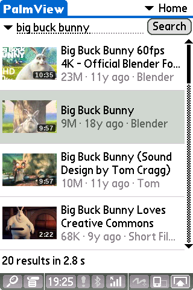
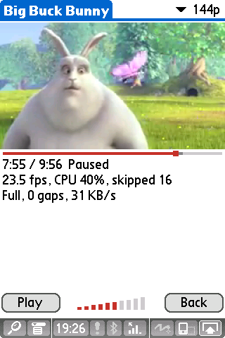

# PalmView

PalmView is a YouTube client for Palm OS 5, developed and tested on the Palm TX. It can search YouTube, play videos, or save them to an SD card for offline viewing.

The app runs entirely on the handheld, no helper server or proxy required. It fetches H.264 and AAC streams directly from YouTube over HTTPS, with TLS provided by [PalmTLS](https://github.com/palmsnipe/palm-tls). It decodes the streams in native ARM code, fast enough to play videos at 144p on a stock Palm TX. It may also work on other Palm OS 5 devices with sufficient memory.

> [!NOTE]
> This project is a proof of concept. It was built to see if a handheld from 2005 could still play modern YouTube. It mostly works, but it's far from a polished app.
> The code was developed with AI assistance. Use it at your own risk.

## Screenshots

| Search | Playback |
| :---: | :---: |
|  |  |

## Requirements

- A device running Palm OS 5 with an ARM processor and a 16-bit color screen.
- Network access through Net.lib, such as built-in Wi-Fi.
- Enough dynamic heap. On the TX, there's about 2.9 MB of free memory before playback, which is enough for 144p and 240p.
- SD card for storing downloads. Not required for streaming.
- Optional: Install CJKOS and set it to Shift-JIS to display Japanese in video titles and search results.

## Installation

Download the two files from the [latest release](https://github.com/OPerepadia/PalmView/releases/latest) and install them into handheld memory:

- `PalmTLSArm.prc`: the TLS library for HTTPS.
- `PalmView.prc`: the app itself.

## Usage

1. Type a search query and tap **Search**.
2. Select a video from the list by tapping it or pressing the 5-way centre button.
3. The **Video Details** screen opens. Select a quality at the top right, then choose:
    - **Play**: streams the video in a built-in player
    - **Download**: saves it to the SD card

Downloaded videos are stored in `/PalmView` on the card. Open **Downloads** from the menu at the top right to play saved videos.

During playback:

- **Play/Pause**: 5-way centre or the **Pause** button
- **Volume**: 5-way up and down
- **Seek**: Tap or drag the bar under the video; or use 5-way left and right to seek 10 s
- **Full screen**: Tap the picture to enter full screen; tap again for normal view
- **Video quality**: The 144p/240p toggle at the top right

## Limitations

- Only 144p and 240p are supported. 144p plays fine at the stock clock. 240p plays at half the frame rate (~12 fps), and needs an overclock to keep up even with that. Overclocking is at your own risk.
  - On a TX, warpSpeed settings of BUS 20 and CPU:BUS 4 (260 MHz bus, 520 MHz CPU) work well. Raising the bus further may reset or freeze the device.
  - Set the overclock for PalmView only, not as the System Default for all apps.
  - See [240p](docs/technical.md#240p) for measurements.
- Only H.264 and AAC codecs are supported. YouTube still serves low resolution streams with these codecs.
- Live streams, "made for kids", age-restricted and members-only videos are not supported.

## How it works

- **API.** PalmView identifies itself as the YouTube app for visionOS. YouTube provides this client with direct stream URLs, eliminating the need to run JavaScript on the Palm.
- **HTTPS.** YouTube only works over HTTPS with modern TLS, which Palm OS lacks. [PalmTLS](https://github.com/palmsnipe/palm-tls) brings it to Palm OS (many thanks to its author).
  Use PalmTLS 0.1.3 or later. Its native ARM ChaCha20-Poly1305 decrypts fast enough for video.
- **Streaming.** YouTube serves video and sound as separate streams. Both streams are buffered in RAM and played as they arrive. Nothing is written to the SD card during streaming.
- **Decoding.** Palm OS 5 runs regular apps in a 68K emulator, which is too slow for video. H.264 and AAC are decoded in native ARM code with FFmpeg's decoders.
  Frames go straight to screen memory, timed to the sound.
- **Quality adjustment.** When decoding falls behind, the app lowers the decoding quality in steps. It raises it again when the CPU has time to spare.
- **Downloads.** Video and audio are downloaded separately and merged into a regular MP4 file. It plays in the app or in other players, such as CorePlayer.
- **Thumbnails.** Decoded in native ARM code with [TJpgDec](https://elm-chan.org/fsw/tjpgd/) by ChaN.

## Build

You need Linux or macOS, with Docker, Node.js, ImageMagick, Clang,
autotools, `arm-none-eabi-gcc` with newlib, and Python 3.

```sh
tools/fetch-toolchain.sh
tools/fetch-deps.sh
tools/build-arm-deps.sh
make dist
```

The PRCs end up in `dist/`.

See [docs/technical.md](docs/technical.md) for more details on how PalmView works,
the tests, debugging tools, etc.

## Credits

- [PalmTLS](https://github.com/palmsnipe/palm-tls) brings modern TLS to Palm OS.
- [FFmpeg](https://ffmpeg.org/) decodes H.264 video and AAC sound.
- [TJpgDec](https://elm-chan.org/fsw/tjpgd/) decodes thumbnails.

## License

GPL-3.0-or-later. PalmTLS and its HTTP component are GPLv3.
The ARM thumbnail module contains TJpgDec by ChaN (its own permissive
license). The ARM decoder module also contains FFmpeg (LGPL-2.1-or-later, built without GPL
parts), musl's libm (MIT) and parts of newlib.

Downloading from YouTube may break its terms of service.
